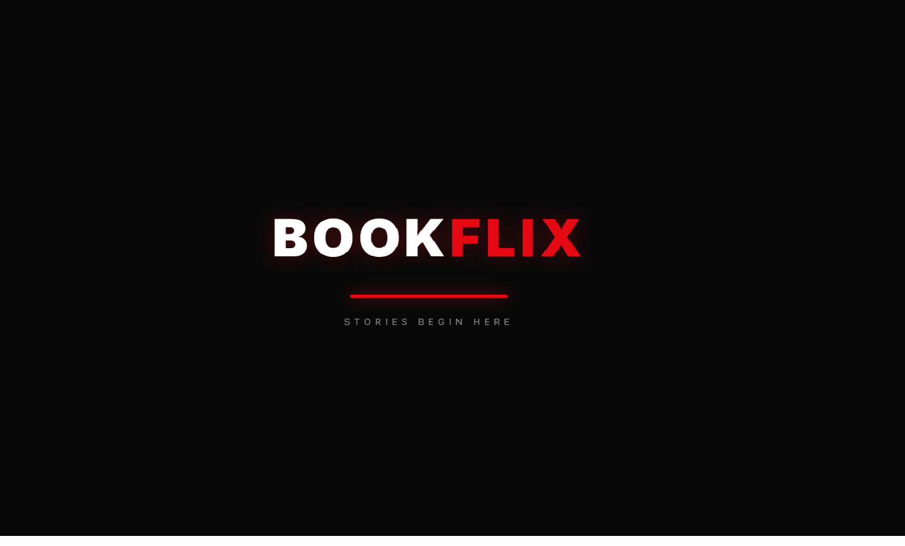
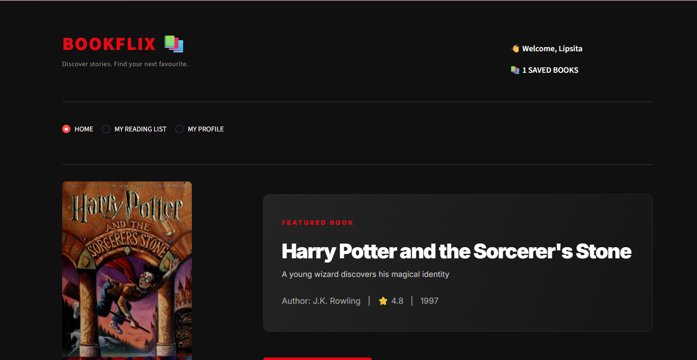

# 📚 BookFlix — Discover Your Next Read

A Netflix-inspired book discovery and recommendation platform built using Python and Streamlit.

BookFlix helps readers explore books, discover similar titles and maintain a personalised reading collection through an interactive interface.

## ✨ Features

- **Book Discovery:** Browse a collection of books with cover images and descriptions.
- **Search & Filters:** Search books by title or author and filter by genre.
- **Book Details:** Explore book descriptions, authors, publication years and ratings.
- **Content-Based Recommendations:** Discover similar books using TF-IDF vectorisation and cosine similarity.
- **My Reading List:** Save and manage books you want to read.
- **Rating & Reviews:** Rate books and share written reviews.
- **Reader Profile:** Create a display profile and view reading activity statistics.
- **Dark UI:** Netflix-inspired interface with a cinematic introduction.

## 🧠 Recommendation System

BookFlix uses a content-based filtering approach.

The recommendation engine considers:
- Book title
- Author
- Genre
- Description
- Themes

TF-IDF (Term Frequency–Inverse Document Frequency) converts book information into numerical vectors.

Cosine similarity compares these vectors to identify books with similar content.

The system then displays the most similar books as recommendations.

*The similarity percentage indicates content similarity, not the probability that a reader will enjoy a book.*

## 🛠️ Tech Stack

| Technology | Purpose |
|---|---|
| Python | Core programming language |
| Streamlit | Web application interface |
| Pandas | Dataset handling |
| NumPy | Numerical operations |
| Scikit-learn | Machine learning |
| TF-IDF | Text vectorisation |
| Cosine Similarity | Book similarity calculation |
| Git & GitHub | Version control |

## 📁 Project Structure

```text
BookFlix/
│
├── app.py
├── requirements.txt
├── .gitignore
│
├── data/
│   └── books.csv
│
└── utils/
    └── recommendations.py
```

## ⚙️ Run Locally

### 1. Clone the repository

```bash
git clone https://github.com/LipsitaTripathy/BookFlix.git
```

### 2. Navigate to the project directory

```bash
cd BookFlix
```

### 3. Install dependencies

```bash
pip install -r requirements.txt
```

### 4. Run the application

```bash
streamlit run app.py
```

The application will open in your browser at:

`http://localhost:8501`

## 🚀 Future Improvements

- Multi-user authentication and individual reader accounts.
- Cloud database integration.
- Personalised reading lists across devices.
- Improved recommendation techniques.
- Expanded book dataset.
- Online deployment.

## 👩‍💻 Developer

**Lipsita Tripathy**

B.Tech — Computer Science Engineering (AI & ML)

GitHub: [LipsitaTripathy](https://github.com/LipsitaTripathy)

LinkedIn: [Connect with me](https://www.linkedin.com/in/lipsita-tripathy-b2b19728a/)

---

*BookFlix — Stories begin here.*
## 🎬 Application Preview

### BookFlix Intro


### BookFlix Homepage
